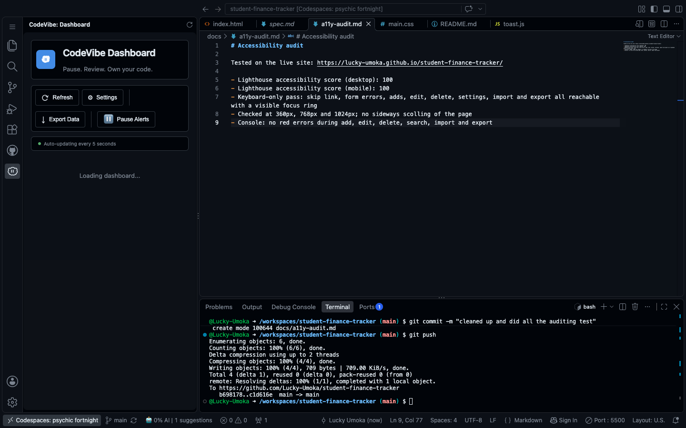

# Codevibe Report

I could not export a CodeVibe JSON report for this project.

- Codevibe (version 0.1.12) was installed in my Github Codespace on 15 October 2026, after my first milestones were already committed. It only recorded activity from that point.
- The dashboard stays on "Loading dashboard..." and the "Export Data" button doesn't work or produce any file. I uninstalled and reinstalled it and the problem is still the same.
- I opened an issue on the CodeVibe repository about this: https://github.com/waka-man/codevibe/issues/27 

